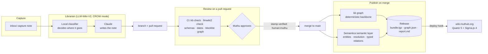
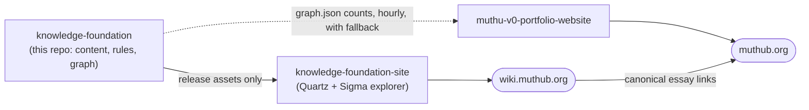

# Knowledge Foundation

**A governed, machine-readable knowledge base, kept by an LLM librarian and approved by a human, published as a graph.**

[](https://github.com/muthub-ai/knowledge-foundation/actions/workflows/tests.yml)
[](https://github.com/muthub-ai/knowledge-foundation/actions/workflows/publish.yml)
[](https://github.com/muthub-ai/knowledge-foundation/releases/latest)
[](LICENSE)
[](CONTENT-LICENSE)

**Live:** [wiki.muthub.org](https://wiki.muthub.org) · **Essays:** [muthub.org](https://muthub.org) · **Site repo:** [knowledge-foundation-site](https://github.com/muthub-ai/knowledge-foundation-site) · **Replicate it:** [docs/plan](docs/plan/README.md)

This repository is Muthu Bommiah's public working knowledge on governed AI, context engineering and AI-native software
delivery, held as an [Open Knowledge Format](https://github.com/GoogleCloudPlatform/open-knowledge-format) v0.2 bundle.
It is also a working reference for the argument the essays make: **AI can write into a system of record only if every
claim carries its source, every change goes through review, and machine output is kept apart from what a person stood
behind.**

| | |
|---|---|
| **Notes** | 51 across five themes, each with dated sources and a review state |
| **Graph** | deterministic backbone (links, declared relations, sources) plus a labelled semantic layer: ~90 entities and ~40 machine-suggested relations per release |
| **Governance** | no bot commits to `main`; owner approval stamps `verified`; confidential-terms scan on every change; 16 decision records |
| **Quality gates** | 64 unit tests, an end-to-end flow test, JSON Schema checks, date rules, a Semantica canary per extraction method |
| **Output** | a versioned release per merge (`bundle.tgz`, `graph.json`, `report.md`) that rebuilds wiki.muthub.org |

## Architecture



Three repositories, one direction of dependency:



The site never imports code from this repository, and muthub.org never needs the wiki to be up (ADR 004, 011, 015).

## Design principles

1. **Git is the system of record** (ADR 001). Notes are Markdown with YAML frontmatter: identity, kind, sources,
   `generated`, `verified`, `stale_after`. Any tool can read them; nothing is locked in a database.
2. **Durable knowledge, replaceable intelligence** (ADR 002, 013). A local classifier routes; Claude writes through the
   API; either can be swapped without touching the bundle.
3. **Nothing is "reviewed" until a person says so** (ADR 004, 006). Bots open pull requests; only the owner's approval
   stamps `verified: human:muthu`; only a merge publishes.
4. **Every claim has a dated source** (ADR 007, 008). Own material is kept in full; third-party material only as notes
   and a short excerpt. A note may not cite a source published after it.
5. **Deterministic first, semantic second** (ADR 009, 016). The graph backbone uses no model. The semantic layer adds
   machine-found entities and suggested relations, labelled as such, hidden by default on the site, never overriding
   an authored edge, and promoted only through a reviewed pull request.
6. **Public knowledge only** (ADR 012). A private blocklist runs locally and in CI; the checker never prints a matched term.

## How a note gets here

| Step | What happens | Where |
|---|---|---|
| 1. Capture | A capture note with `title`, `published_at`, `origin_kind`, `license_note` | `inbox/` |
| 2. File | The local classifier picks the theme, matches existing notes and relations; Claude writes | `make ingest`, `tools/librarian/` |
| 3. Curate | Claude Code tidies, links and checks, then opens the pull request with a claims table | `make curate`, `skills/` |
| 4. Check | Schemas, dates, links, confidential terms, LLM-Wiki-V2's own checks, graph build | `.github/workflows/tests.yml` |
| 5. Approve | Owner approval stamps `verified` on the changed notes, with the GitHub App's token | `approve.yml` |
| 6. Publish | Merge cuts a release with the graph and the semantic layer; the deploy hook rebuilds the site | `publish.yml` |
| 7. Keep fresh | Weekly lint, consolidation and stale-note report, capped spend | `weekly.yml`, `make stale` |

## The graph and the semantic layer

`kb graph` writes `graph.json` (the contract with the site, `schemas/graph.schema.json`), `graph.graphml` and `report.md`.

- **Backbone (deterministic):** theme membership, links in the text, typed relations declared in frontmatter
  (`ontology/edge-types.yaml`), and sources with publication dates.
- **Semantic layer ([Semantica](https://github.com/semantica-agi/semantica), behind a one-function adapter):**
  - *Ontology-constrained extraction*: five entity types (Concept, Standard, Tool, Organization, Practice).
  - *Entity resolution*: spelling and plural folding, Semantica's `EntityResolver`, an acronym rule (MCP → Model
    Context Protocol, never MCP server) and one checked model pass; merged entities keep their aliases.
  - *Typed relations between notes*: the model may use only the ontology's relation types, only for candidate notes it
    was shown, and must quote the supporting sentence; a proposal whose quote is not in the note is dropped.
  - `kb propose` writes chosen suggestions into frontmatter for a reviewed pull request.
- **Canary:** every pull request runs the extractor with each method (`pattern`, `ml`, `llm`) against the real notes
  and publishes what it found, the library's warnings and the timing as check annotations. The story of why that
  canary exists is the essay [Six runs, one canary](https://muthub.org/writing/six-runs-one-canary-governed-extraction).

## Quickstart

```bash
python3 -m venv .venv && source .venv/bin/activate
pip install -r requirements.txt          # add requirements-graph.txt for the semantic layer
make test                                 # unit tests + end-to-end flow (scripted models, no network)
make check                                # the rules CI runs on every pull request
make graph                                # dist/graph.json, graph.graphml, report.md
```

Full setup, including the local classifier, the GitHub App, secrets, branch protection and the semantic layer, is in
[docs/plan](docs/plan/README.md).

## Repository map

| Path | What it is |
| --- | --- |
| `wiki/` | The OKF bundle: theme folders, notes, `raw/` source copies, `index.md` and `log.md` per folder |
| `wiki.config.yaml` | Name, site, themes and routing descriptions, kinds, re-verification periods, models |
| `inbox/` | Captures waiting to be filed (`TEMPLATE.md.txt`); processed ones move to `inbox/done/` |
| `tools/kb/` | Governance: validate, dates, blocklist, normalize, stamp, propose, graph, evals |
| `tools/kb/extractors/` | The semantic layer: Semantica adapter, entity resolution, typed relations |
| `tools/librarian/` | Ingest through LLM-Wiki-V2; the one-off seed from muthub.org |
| `ontology/`, `schemas/` | Edge types; JSON Schemas for notes, source copies and the graph |
| `skills/`, `prompts/`, `AGENTS.md` | The curator agent's standing orders and procedures; house style for the Librarian |
| `evals/questions.yaml` | 20 questions with the note that should answer each |
| `decisions/` | [Architecture decision records](decisions/README.md) |
| `docs/plan/` | [Step-by-step plan to build this again](docs/plan/README.md) |
| `tests/` | Unit tests and the end-to-end flow test |

## Operations

- **Releases:** one per merge to `main`, tagged `kf-YYYY.MM.DD-N`. The site always builds from the latest release;
  roll back by re-publishing an older tag's assets or reverting the merge.
- **Switches:** repository variables `GRAPH_EXTRACTOR`, `SEMANTICA_NER_METHOD`, `SEMANTICA_RELATIONS` (`none` turns the
  semantic layer off without a code change).
- **Cost:** the semantic layer is a few cents of API use per release; the weekly curator is capped at $5 per run.
- **Runbook and failure modes:** [docs/plan/06-operations.md](docs/plan/06-operations.md).

## Licences

Code: MIT ([LICENSE](LICENSE)), except `tools/librarian/` and `tests/test_flow.py`, which import LLM-Wiki-V2 and are
AGPL-3.0-or-later ([LICENSES](LICENSES/README.md)). Notes: CC BY 4.0 ([CONTENT-LICENSE](CONTENT-LICENSE)).
Views are the author's own and do not represent his employer.
