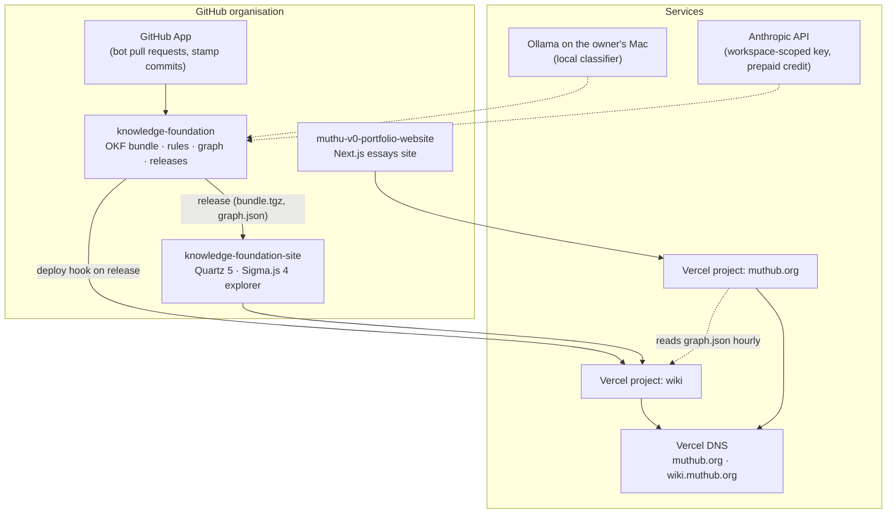

# Plan: build the Knowledge Foundation system again

These documents are the replication plan for the three-repository system behind
[wiki.muthub.org](https://wiki.muthub.org) and [muthub.org](https://muthub.org). They are written so that someone with
a GitHub organisation, a Vercel account, a domain and an Anthropic API key can rebuild it end to end, in order, and
know at each step how to check it worked. Every gotcha we actually hit is recorded where it bites.

## The system in one picture

## Order of work

| # | Document | Outcome | Rough time |
|---|---|---|---|
| 1 | [01-repository-and-bundle.md](01-repository-and-bundle.md) | The knowledge repository with a valid OKF bundle, rules and tests | half a day |
| 2 | [02-librarian.md](02-librarian.md) | Captures filed by LLM-Wiki-V2: a local classifier decides, Claude writes | 2 hours |
| 3 | [03-github-automation.md](03-github-automation.md) | GitHub App, secrets, workflows, branch protection: bots propose, the owner approves | 2 hours |
| 4 | [04-graph-and-semantic-layer.md](04-graph-and-semantic-layer.md) | `graph.json` with a deterministic backbone and the Semantica layer, guarded by a canary | half a day |
| 5 | [05-releases-and-site.md](05-releases-and-site.md) | Each merge cuts a release that rebuilds the wiki site | 1 hour (plus the site repo's own plan) |
| 6 | [06-operations.md](06-operations.md) | Runbook: daily use, failure modes, costs, rollback | reference |

The website itself is planned in [knowledge-foundation-site/docs/plan](https://github.com/muthub-ai/knowledge-foundation-site/tree/main/docs/plan)
and the essays site in [muthu-v0-portfolio-website/docs/plan](https://github.com/muthub-ai/muthu-v0-portfolio-website/tree/main/docs/plan).

## Accounts and prerequisites

| Need | Why | Notes |
|---|---|---|
| GitHub organisation | Three public repositories, a GitHub App, branch protection | Free plan is enough |
| Vercel account | Two projects (wiki, essays) and DNS for the domain | Hobby plan works; previews are private by default |
| A domain | `example.org` and `wiki.example.org` | Point the nameservers at Vercel to manage both records there |
| Anthropic Console account | API key for Claude (writing) and Haiku (semantic layer) | **Separate from a Claude subscription**: API use is billed to prepaid credit. Create the key **inside a workspace** |
| A Mac (or Linux box) with Python 3.12 | Ingest, the local classifier, local checks | Ollama 0.35+ for the classifier |
| Node 22, pnpm 10 | The two websites | pnpm 10 because `pnpm-workspace.yaml` uses pnpm 10 settings |

## Ground rules that shape every step

- **No automated commit ever reaches `main`.** Bots work on branches and open pull requests; the owner merges.
- **Nothing is marked reviewed until the owner approves** the pull request that changed it.
- **Machine output is labelled and kept apart** from authored structure, all the way to the pixels on the site.
- **A private blocklist** of terms that must never be published runs locally and in CI, and never prints what it matched.
- **Every decision is recorded** as an ADR in `decisions/` before or with the change that implements it.
